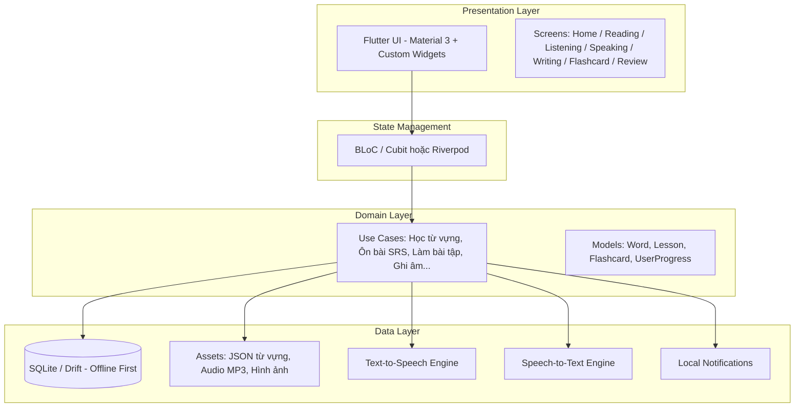
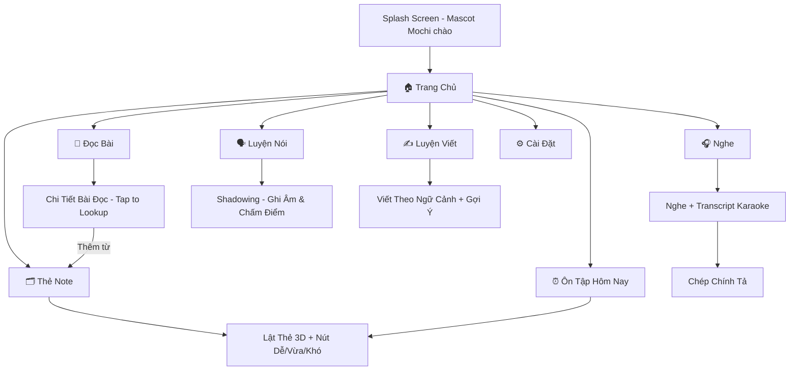

# 📘 Kế Hoạch Phát Triển App Học Tiếng Anh (Flutter)

> **Tên dự án gợi ý:** `LingoBuddy` — Bạn đồng hành học tiếng Anh  
> **Nền tảng:** Flutter (Dart) → Android, iOS, Web, Desktop  
> **Trình độ khởi đầu:** B1 (Intermediate)  
> **Phong cách thiết kế:** Soft Cozy Minimalism — Dễ thương, tối giản, ấm áp

---

## 1. Kiến Trúc Tổng Quan



---

## 2. Cấu Trúc Thư Mục Dự Án

```
linguo_buddy/
├── lib/
│   ├── main.dart                    # Entry point
│   ├── app.dart                     # MaterialApp, Theme, Routes
│   │
│   ├── core/                        # Hạ tầng dùng chung
│   │   ├── theme/
│   │   │   ├── app_colors.dart      # Bảng màu Pastel
│   │   │   ├── app_typography.dart   # Font Nunito/Quicksand
│   │   │   └── app_theme.dart       # ThemeData tổng hợp
│   │   ├── constants/
│   │   │   └── srs_constants.dart   # Hệ số thuật toán Spaced Repetition
│   │   ├── utils/
│   │   │   ├── audio_helper.dart
│   │   │   └── date_helper.dart
│   │   └── widgets/                 # Widget tái sử dụng
│   │       ├── mascot_widget.dart   # Linh vật đồng hành
│   │       ├── flip_card.dart       # Thẻ lật 3D
│   │       ├── audio_player_bar.dart
│   │       └── progress_ring.dart
│   │
│   ├── data/                        # Tầng dữ liệu
│   │   ├── database/
│   │   │   ├── app_database.dart    # Drift (SQLite) schema
│   │   │   └── dao/                 # Data Access Objects
│   │   │       ├── word_dao.dart
│   │   │       ├── lesson_dao.dart
│   │   │       └── review_dao.dart
│   │   ├── models/
│   │   │   ├── word.dart
│   │   │   ├── lesson.dart
│   │   │   ├── flashcard.dart
│   │   │   └── user_progress.dart
│   │   └── repositories/
│   │       ├── vocabulary_repository.dart
│   │       ├── lesson_repository.dart
│   │       └── review_repository.dart
│   │
│   ├── features/                    # Từng tính năng chính
│   │   ├── home/
│   │   │   ├── home_screen.dart     # Dashboard chính
│   │   │   └── home_cubit.dart
│   │   │
│   │   ├── reading/                 # 📖 Đọc bài
│   │   │   ├── reading_screen.dart
│   │   │   ├── reading_detail_screen.dart
│   │   │   ├── widgets/
│   │   │   │   ├── tap_to_lookup.dart    # Chạm từ tra nghĩa
│   │   │   │   └── bilingual_toggle.dart # Bật/tắt song ngữ
│   │   │   └── reading_cubit.dart
│   │   │
│   │   ├── listening/               # 🎧 Nghe
│   │   │   ├── listening_screen.dart
│   │   │   ├── widgets/
│   │   │   │   ├── karaoke_transcript.dart  # Chữ highlight theo audio
│   │   │   │   ├── speed_selector.dart      # 0.8x / 1.0x / 1.2x
│   │   │   │   └── dictation_exercise.dart  # Chép chính tả
│   │   │   └── listening_cubit.dart
│   │   │
│   │   ├── speaking/                # 🗣️ Nói
│   │   │   ├── speaking_screen.dart
│   │   │   ├── widgets/
│   │   │   │   ├── record_button.dart       # Nút ghi âm giữ nhấn
│   │   │   │   └── pronunciation_score.dart # Điểm phát âm %
│   │   │   └── speaking_cubit.dart
│   │   │
│   │   ├── writing/                 # ✍️ Viết
│   │   │   ├── writing_screen.dart
│   │   │   ├── widgets/
│   │   │   │   └── sentence_starters.dart   # Gợi ý cấu trúc B1
│   │   │   └── writing_cubit.dart
│   │   │
│   │   ├── flashcard/               # 🗂️ Thẻ Note
│   │   │   ├── flashcard_screen.dart
│   │   │   ├── widgets/
│   │   │   │   ├── flashcard_3d.dart        # Thẻ lật 3D đẹp
│   │   │   │   └── srs_buttons.dart         # Dễ / Vừa / Khó
│   │   │   └── flashcard_cubit.dart
│   │   │
│   │   ├── review/                  # ⏰ Ôn tập & Nhắc bài
│   │   │   ├── review_screen.dart
│   │   │   └── review_cubit.dart
│   │   │
│   │   └── settings/                # ⚙️ Cài đặt
│   │       ├── settings_screen.dart
│   │       └── notification_settings.dart
│   │
│   └── services/                    # Dịch vụ hệ thống
│       ├── audio_service.dart       # just_audio
│       ├── tts_service.dart         # flutter_tts
│       ├── stt_service.dart         # speech_to_text
│       ├── notification_service.dart # flutter_local_notifications
│       └── srs_engine.dart          # Thuật toán lặp lại ngắt quãng
│
├── assets/
│   ├── data/
│   │   ├── b1_vocabulary.json       # 500 từ vựng B1
│   │   ├── b1_readings.json         # 10-20 bài đọc
│   │   └── b1_listening.json        # Metadata bài nghe
│   ├── audio/
│   │   ├── words/                   # Audio từng từ vựng
│   │   └── lessons/                 # Audio bài đọc/nghe
│   ├── images/
│   │   └── mascot/                  # Hình linh vật các trạng thái
│   └── fonts/
│       └── Nunito/                  # Font chữ tùy chọn
│
├── pubspec.yaml                     # Dependencies
└── README.md
```

---

## 3. Các Package Flutter Cần Dùng

| Chức năng | Package | Mục đích |
| :--- | :--- | :--- |
| **Database offline** | `drift` + `sqlite3_flutter_libs` | Lưu từ vựng, tiến độ, ghi chú người dùng |
| **State management** | `flutter_bloc` hoặc `flutter_riverpod` | Quản lý trạng thái theo kiến trúc rõ ràng |
| **Phát audio** | `just_audio` | Phát file phát âm từ vựng, bài nghe |
| **Text-to-Speech** | `flutter_tts` | Đọc từ/câu khi chưa có file audio sẵn |
| **Speech-to-Text** | `speech_to_text` | Nhận diện giọng nói cho tính năng Luyện nói |
| **Thông báo nhắc bài** | `flutter_local_notifications` | Push notification nhắc ôn bài theo giờ |
| **Animation lật thẻ** | `flip_card` hoặc tự viết `AnimationController` | Hiệu ứng lật thẻ flashcard 3D |
| **Animation linh vật** | `rive` hoặc `lottie` | Mascot chuyển động vui nhộn |
| **Routing** | `go_router` | Điều hướng giữa các màn hình |
| **DI (Dependency Injection)** | `get_it` + `injectable` | Tiêm phụ thuộc, tách lớp code sạch |

---

## 4. Thiết Kế Giao Diện (UI/UX)

### Bảng màu Pastel "Cozy"

| Vai trò | Màu | Mã hex |
| :--- | :--- | :--- |
| Nền chính | Trắng kem sữa | `#FAF9F6` |
| Nền card | Trắng tinh | `#FFFFFF` |
| Nhấn chính | Xanh Matcha dịu | `#8FA89B` |
| Nhấn phụ | Cam đào pastel | `#F8B195` |
| Chữ chính | Xám than | `#2D2D2D` |
| Chữ phụ | Xám nhạt | `#8E8E8E` |
| Thành công | Xanh lá nhạt | `#A8D5BA` |
| Cảnh báo | Hồng cam nhạt | `#F4A9A8` |

### Font chữ
- **Tiêu đề:** Nunito Bold / Quicksand Bold
- **Nội dung:** Nunito Regular
- **Phiên âm IPA:** Noto Sans (hỗ trợ ký tự IPA đầy đủ)

### Linh vật (Mascot)
- Gợi ý: **Chú mèo nhỏ đeo kính** (tên: Mochi)
- Trạng thái: Vui (hoàn thành bài), Buồn ngủ (lâu không học), Cổ vũ (đang ôn bài), Ngạc nhiên (streak dài)
- Dùng Rive/Lottie để tạo animation nhẹ, mượt

---

## 5. Thiết Kế Cơ Sở Dữ Liệu (SQLite / Drift)

### Bảng `words` — Kho từ vựng

| Cột | Kiểu | Mô tả |
| :--- | :--- | :--- |
| `id` | INTEGER PK | ID tự tăng |
| `word` | TEXT | Từ tiếng Anh |
| `ipa` | TEXT | Phiên âm IPA |
| `meaning_vi` | TEXT | Nghĩa tiếng Việt |
| `example_en` | TEXT | Câu ví dụ tiếng Anh |
| `example_vi` | TEXT | Dịch câu ví dụ |
| `audio_path` | TEXT | Đường dẫn file audio |
| `image_path` | TEXT | Hình minh họa (nullable) |
| `level` | TEXT | B1, B2, C1... |
| `topic` | TEXT | Chủ đề (Travel, Work, Technology...) |

### Bảng `flashcards` — Thẻ ôn tập SRS

| Cột | Kiểu | Mô tả |
| :--- | :--- | :--- |
| `id` | INTEGER PK | ID tự tăng |
| `word_id` | INTEGER FK | Liên kết tới bảng words |
| `user_note` | TEXT | Ghi chú cá nhân của người dùng |
| `ease_factor` | REAL | Hệ số dễ (mặc định 2.5) |
| `interval_days` | INTEGER | Số ngày đến lần ôn tiếp theo |
| `repetitions` | INTEGER | Số lần đã ôn |
| `next_review` | TEXT (ISO date) | Ngày ôn tiếp theo |
| `last_review` | TEXT (ISO date) | Ngày ôn gần nhất |

### Bảng `lessons` — Bài đọc / Bài nghe

| Cột | Kiểu | Mô tả |
| :--- | :--- | :--- |
| `id` | INTEGER PK | ID tự tăng |
| `title` | TEXT | Tiêu đề bài |
| `content_en` | TEXT | Nội dung tiếng Anh |
| `content_vi` | TEXT | Bản dịch tiếng Việt |
| `audio_path` | TEXT | Audio bài đọc (nullable) |
| `type` | TEXT | "reading" hoặc "listening" |
| `topic` | TEXT | Chủ đề |
| `level` | TEXT | B1 |
| `word_count` | INTEGER | Số từ trong bài |

### Bảng `user_progress` — Tiến độ học

| Cột | Kiểu | Mô tả |
| :--- | :--- | :--- |
| `id` | INTEGER PK | ID tự tăng |
| `date` | TEXT (ISO date) | Ngày học |
| `words_learned` | INTEGER | Số từ mới học |
| `words_reviewed` | INTEGER | Số từ đã ôn |
| `lessons_completed` | INTEGER | Số bài đã hoàn thành |
| `study_minutes` | INTEGER | Tổng phút học trong ngày |
| `streak_days` | INTEGER | Chuỗi ngày học liên tục |

---

## 6. Thuật Toán Spaced Repetition (SRS) — SM-2 Đơn Giản Hóa

```
Khi người dùng đánh giá một thẻ:

  quality = 0 (Khó/Quên) | 1 (Vừa/Nhớ mờ) | 2 (Dễ/Nhớ rõ)

  NẾU quality == 0:
      repetitions = 0
      interval = 0  (lặp lại ngay trong phiên)
      ease_factor giảm 0.2

  NẾU quality == 1:
      NẾU repetitions == 0 → interval = 1 ngày
      NẾU repetitions == 1 → interval = 3 ngày
      NGƯỢC LẠI      → interval = interval × ease_factor
      repetitions += 1

  NẾU quality == 2:
      NẾU repetitions == 0 → interval = 3 ngày
      NẾU repetitions == 1 → interval = 7 ngày
      NGƯỢC LẠI      → interval = interval × ease_factor × 1.3
      repetitions += 1
      ease_factor tăng 0.1

  ease_factor luôn >= 1.3 (sàn)
  next_review = hôm_nay + interval ngày
```

---

## 7. Luồng Màn Hình Chính (Screen Flow)



---

## 8. Lộ Trình Phát Triển Theo Giai Đoạn

### 🟢 Giai đoạn 1 — Nền tảng & Flashcard (Tuần 1–2)

| Ngày | Công việc |
| :--- | :--- |
| **Ngày 1** | Khởi tạo project Flutter, cấu hình `pubspec.yaml`, thiết lập cấu trúc thư mục |
| **Ngày 2** | Xây dựng `core/theme/` — Bảng màu, font, ThemeData. Tạo Splash Screen với mascot |
| **Ngày 3** | Tạo database Drift: bảng `words`, `flashcards`. Chuẩn bị file `b1_vocabulary.json` (300 từ đầu tiên) |
| **Ngày 4–5** | Xây `Home Screen` — Dashboard với các nút tính năng, tiến độ hôm nay, mascot Mochi |
| **Ngày 6–7** | Xây tính năng **Thẻ Note (Flashcard)**: Hiển thị thẻ lật 3D, phát audio, nút Dễ/Vừa/Khó |
| **Ngày 8–9** | Cài đặt thuật toán SRS. Tạo màn **Ôn Tập Hôm Nay** — chỉ hiện thẻ đến hạn |
| **Ngày 10** | Test trên Android thật + sửa bug UI |

> **Kết quả:** App chạy được trên Android, có kho 300 từ B1, lật flashcard đẹp, ôn bài SRS tự động xếp lịch.

### 🟡 Giai đoạn 2 — Đọc Bài & Nghe (Tuần 3–4)

| Ngày | Công việc |
| :--- | :--- |
| **Ngày 11–12** | Tạo bảng `lessons`, soạn 10 bài đọc B1 (JSON). Xây màn danh sách bài đọc |
| **Ngày 13–14** | Xây **Chi Tiết Bài Đọc**: Tap-to-Lookup (chạm từ → popup nghĩa + nút thêm vào thẻ note), toggle song ngữ |
| **Ngày 15–16** | Tích hợp `just_audio` + `flutter_tts`. Phát audio bài đọc, phát âm từ vựng |
| **Ngày 17–18** | Xây tính năng **Nghe**: Transcript karaoke (highlight từ theo audio), điều chỉnh tốc độ |
| **Ngày 19** | Xây bài tập **Chép Chính Tả** (Dictation): Nghe câu → gõ lại → so sánh |
| **Ngày 20** | Test + sửa bug toàn bộ GĐ 1 & 2 |

> **Kết quả:** Có bài đọc tương tác, tra từ ngay trong bài, bài nghe với transcript karaoke.

### 🔴 Giai đoạn 3 — Nói, Viết & Nhắc Bài (Tuần 5–6)

| Ngày | Công việc |
| :--- | :--- |
| **Ngày 21–22** | Tích hợp `speech_to_text`. Xây **Luyện Nói (Shadowing)**: Nghe câu mẫu → ghi âm → so sánh % từ đúng |
| **Ngày 23–24** | Xây **Luyện Viết**: Giao bài viết theo ngữ cảnh B1, hiện gợi ý cấu trúc câu (sentence starters) |
| **Ngày 25** | Cài đặt `flutter_local_notifications`: Nhắc ôn bài theo giờ do người dùng chọn |
| **Ngày 26** | Xây màn **Cài Đặt**: Chọn giờ nhắc bài, bật/tắt âm thanh, reset tiến độ |
| **Ngày 27** | Xây **Widget màn hình chính** (Android): Hiện từ vựng trong ngày + streak |
| **Ngày 28** | Kiểm thử toàn diện trên Android & iOS (nếu có máy Mac) |

> **Kết quả:** App hoàn chỉnh với đầy đủ 4 kỹ năng Nghe - Nói - Đọc - Viết + Flashcard SRS + nhắc bài.

---

## 9. Mở Rộng Sau Này (Sau khi B1 ổn định)

| Tính năng | Mô tả |
| :--- | :--- |
| **Thêm trình độ A2, B2, C1** | Mở rộng kho từ vựng và bài theo từng level |
| **Xuất bản Web** | `flutter build web` — Đặt lên hosting để học trên trình duyệt |
| **Xuất Desktop (.exe)** | `flutter build windows` — Học trên laptop |
| **Đồng bộ Cloud** | Tích hợp Supabase/Firebase để sync tiến độ khi đổi thiết bị |
| **Gamification** | Hệ thống điểm XP, huy hiệu, bảng xếp hạng |
| **AI Chat tutor** | Tích hợp API LLM để chat luyện hội thoại B1 với AI |

---

## 10. Lệnh Khởi Tạo Project

```bash
# 1. Cài Flutter SDK (nếu chưa có)
# Tải từ: https://docs.flutter.dev/get-started/install/windows/mobile

# 2. Tạo project mới
flutter create --org com.lingoBuddy lingo_buddy

# 3. Chạy thử
cd lingo_buddy
flutter run
```

---

> [!TIP]
> **Bước tiếp theo:** Xác nhận kế hoạch này, sau đó bắt đầu bằng Giai đoạn 1 — Dựng theme, database và tính năng Flashcard đầu tiên.
